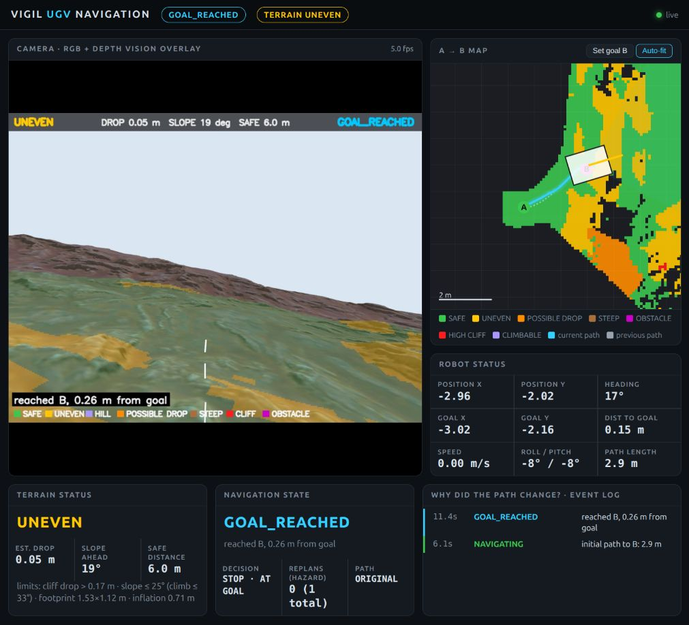
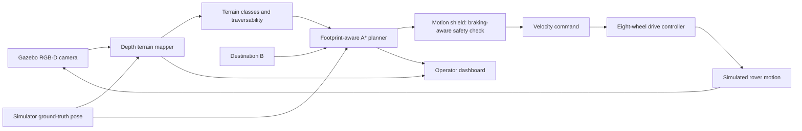
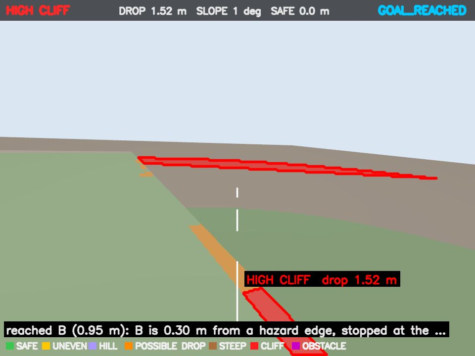
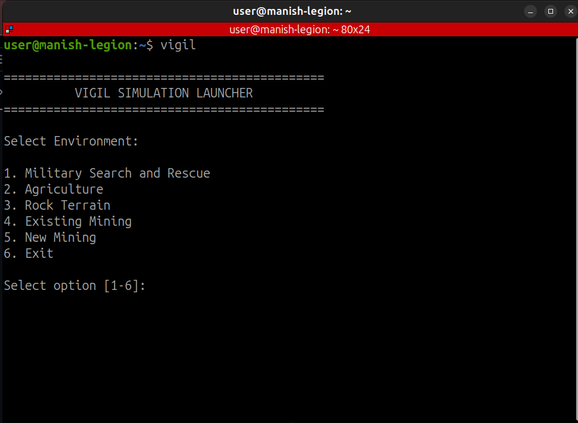

# VIGIL — Vision-Integrated Ground Intelligence and Localization

**Smart India Hackathon 2026 · Problem statement SIH26126 · ROS 2 Jazzy · Gazebo Harmonic**

VIGIL is an eight-wheel unmanned ground vehicle (UGV) developed in simulation. It reads terrain from a depth camera, plans a route that fits the rover's real dimensions, and drives toward a destination while stopping safely when no safe route exists. The same rover concept is used in rough-terrain, agriculture, search-and-rescue and underground-mining environments.

> **Current stage: simulation prototype.** All results below come from Gazebo or offline tests. Nothing has been validated on physical hardware.

[Architecture](docs/architecture.md) · [How navigation works](docs/navigation-workflow.md) · [Setup](docs/setup.md) · [Regression results](docs/REGRESSION_RESULTS.md) · [Project audit](docs/PROJECT_AUDIT.md) · [Evidence and limitations](docs/validation.md) · [Demo plan](docs/DEMO_PLAN.md)



*Live rough-terrain run (27 September 2026) that reported `GOAL_REACHED`. Camera data comes from Gazebo; position comes from `/sim/ground_truth`. [Capture details](docs/validation.md).*

[](https://youtu.be/WZutmP8n8Oc?si=ThVBvrjVecI3OAJ3)

## Contents

1. [Problem statement](#1-problem-statement)
2. [Objectives](#2-objectives)
3. [Architecture](#3-architecture)
4. [Autonomous navigation](#4-autonomous-navigation)
5. [Perception and localization](#5-perception-and-localization)
6. [Terrain safety](#6-terrain-safety)
7. [Gazebo simulation environments](#7-gazebo-simulation-environments)
8. [Installation and execution](#8-installation-and-execution)
9. [Regression results](#9-regression-results)
10. [Known limitations](#10-known-limitations)
11. [Future work](#11-future-work)
12. [Repository layout](#12-repository-layout)
13. [Team and attribution](#13-team-and-attribution)

## 1. Problem statement

**SIH26126** concerns vision-based autonomous navigation for an outdoor UGV in GPS-denied conditions: finding traversable ground, estimating position from visual observations, and avoiding hazards while reaching a destination.

Title as recorded in the team's audit notes: *Vision Based Autonomous Navigation for Unmanned Ground Vehicle for Outdoor environment*. **Not yet verified** against the official SIH portal.

<!-- TEAM: confirm the exact title, ministry/organization and theme as published on the SIH portal, then remove the "not yet verified" note. -->

| Requirement | What exists in this repository | Still to be done |
|---|---|---|
| Detect paths and hazards | Depth-based terrain classification (slope, roughness, steps, drops, cliffs); agricultural geometry and vegetation processing | Benchmark detection accuracy under varied outdoor conditions |
| Visual localization without GPS | New Mining navigates on an RTAB-Map + EKF pose (RGB-D visual odometry, wheels, IMU). Rough terrain, SAR and the agriculture row mission use simulator ground truth | Measure localization error; replace ground-truth pose in the rough-terrain, SAR and agriculture loops |
| Plan and avoid hazards | Footprint-aware A* with a braking-aware motion shield (rough terrain, SAR); Nav2 and a crop-row controller (agriculture) | Moving-obstacle trials and collision instrumentation |
| Autonomous A-to-B operation | Rough terrain: 18/18 Gazebo regression trials passed (6 scenarios × 3) | Hardware trials; broader scenarios |

## 2. Objectives

- Drive from A to B over unstructured terrain using camera-derived terrain geometry.
- Judge every route against the rover's real footprint, wheel size, clearance and climbing limits rather than treating the rover as a point.
- Never drive off a drop: keep a measurable clearance from cliff edges, and stop safely with a stated reason when the goal is unreachable.
- Explain decisions to an operator through a live dashboard.
- Back every claim with reproducible tests and recorded evidence.

## 3. Architecture

The rough-terrain stack is the clearest entry point. [The architecture guide](docs/architecture.md) explains how the other environments differ.



The four environments with code are separate ROS 2 workspaces. They share the rover concept but not one autonomy package. Run one environment at a time.

## 4. Autonomous navigation

1. **Initialize:** start Gazebo, spawn the rover, bridge sensors and activate the wheel controllers (with bounded retries).
2. **Observe:** read depth images, camera calibration and the current pose.
3. **Map terrain:** project depth into a world grid; estimate slope, roughness, steps and drops.
4. **Plan:** A* toward B over a cost map that accounts for the rover footprint and terrain cost.
5. **Check and move:** every velocity command passes the motion shield (section 6) before it reaches the wheels.
6. **Update:** replan on new terrain data, recover when blocked, and stop in a terminal state when the goal is unreachable.
7. **Report:** pose, terrain, decision and reason are shown on the dashboard at http://localhost:8080.

Terminal states: `GOAL_REACHED`, `GOAL_UNREACHABLE`, `RECOVERY_LIMIT_REACHED`, `SENSOR_TIMEOUT`, `LOCALIZATION_LOST`. In every failure state the rover holds zero velocity until a new goal arrives. [Detailed workflow](docs/navigation-workflow.md).

## 5. Perception and localization

**Perception** uses geometric rules on the depth image, not a trained model. Cells are classified as SAFE, UNEVEN, CLIMBABLE, STEEP, OBSTACLE, POSSIBLE DROP or HIGH CLIFF. An edge scan detects drops whose bottom the camera cannot see. [Algorithm details](Rock%20Terrain/src/vigil_rough_terrain/docs/VISION_NAVIGATION.md).

**Localization differs by environment:**

| Environment | Pose used by navigation | Visual localization in the loop |
|---|---|---|
| Rock Terrain | `/sim/ground_truth` | No |
| Search and rescue | `/sim/ground_truth` | No |
| Agriculture, row mission (default) | `/sim/ground_truth` | No |
| Agriculture, Nav2 / frontier mode | EKF (wheels + IMU) with RTAB-Map correction | Partly; accuracy not measured |
| New Mining | RTAB-Map + EKF (RGB-D visual odometry, wheels, IMU) | Yes, structurally; error not measured |

The headline rough-terrain result is therefore *vision-based terrain perception with simulator localization*, not GPS-denied visual navigation. [Details](docs/PROJECT_AUDIT.md#4-localization-by-environment).

## 6. Terrain safety

The rough-terrain navigator applies these checks (added and Gazebo-tested on 25 November 2026):

- **Braking-aware motion shield:** every command is simulated forward, including command latency and the drive's real deceleration (0.5 m/s²), and must keep the footprint at least 0.10 m from cliffs, obstacles and unconfirmed drops until the rover stops.
- **Don't outrun the map:** forward speed is capped so the rover can stop before ground the camera has not confirmed as safe (minimum creep speed 0.15 m/s).
- **No creeping inside the safety margin:** when closer than the margin, a move may not reduce clearance at all.
- **Safe recovery:** reversing and turning use the same check; recoveries that cannot move end the attempt with a reason.
- **Proven ground:** ground the level rover has stood on counts as observed, and an isolated "cliff" cell deep under the body is treated as a mapping artefact.
- **Bounded failure:** unreachable goals end in `GOAL_UNREACHABLE` or `RECOVERY_LIMIT_REACHED` at zero velocity.

[Technical changelog](docs/TECHNICAL_CHANGELOG.md) · [Improvement report](docs/IMPROVEMENT_REPORT.md)



## 7. Gazebo simulation environments

| Environment | Purpose | Folder | Status |
|---|---|---|---|
| Rough terrain | Depth-based terrain interpretation and A-to-B navigation | [`Rock Terrain/`](Rock%20Terrain/) | 18/18 Gazebo regression trials passed; simulator pose |
| Agriculture | Crop-row missions, mapping, perception, lighting, active suspension | [`Agriculture/`](Agriculture/) | Partial row sweeps documented; full field coverage not validated |
| Search and rescue | Navigation followed by thermal search in a disaster world | [`Military Search and Rescue/`](Military%20Search%20and%20Rescue/) | Component and motion records; full SAR mission not verified |
| New Mining (underground) | Point-B navigation with RGB-D visual odometry, RTAB-Map and EKF | [`New Mining/`](New%20Mining/) | Navigation-core unit tests pass; repeated missions not recorded. Gas/temperature/humidity are synthetic. Needs licensed mine assets not in the repository |
| Existing Mining (proposal) | Outdoor mine-route inspection on the rough-terrain foundation | [Mining guide](docs/mining.md) | Documentation only; no ROS package |

[](docs/media/vigil-launcher-menu.png)

## 8. Installation and execution

**Requirements:** Ubuntu 24.04, ROS 2 Jazzy, Gazebo Harmonic, and a GPU/display for the simulated cameras. Install the dependencies listed in [setup](docs/setup.md) first.

```bash
git clone https://github.com/VIGIL-MULTI-PURPOSE-ROBOT/vigil-multi-purpose-ugv.git
cd "vigil-multi-purpose-ugv/Rock Terrain"
source /opt/ros/jazzy/setup.bash
colcon build --symlink-install --packages-select vigil_rough_terrain --cmake-args -DPython3_EXECUTABLE=/usr/bin/python3
source install/local_setup.bash
export ROS_DOMAIN_ID=71
ros2 launch vigil_rough_terrain vision_nav.launch.py                    # default mission
ros2 launch vigil_rough_terrain vision_nav.launch.py scenario:=cliff_front   # cliff test
```

Open **http://localhost:8080** for the camera, terrain map, path and mission state. Stop with **Ctrl+C**.

**Tests (from `Rock Terrain/`, no Gazebo needed):**

```bash
python3 -m pytest -q src/vigil_rough_terrain/test/test_navigation_safety.py   # unit tests
python3 src/vigil_rough_terrain/test/closed_loop_sim.py                        # 13 offline scenarios
python3 -m pytest -q tools/regression/test_metrics.py                          # regression-tool tests
```

**Full Gazebo regression** (offline suites, build, 6 scenarios × 3 trials, with evidence and a Git check):

```bash
bash "Rock Terrain/tools/regression/vigil_regression.sh"                           # runs on the current branch
bash "Rock Terrain/tools/regression/vigil_regression.sh" --trials 1 --scenarios flat   # quick check
```

The runner records the branch and commit it tested. Add `--branch NAME` to make it refuse to run on any other branch.

Other environments: [setup](docs/setup.md) and [operations](docs/operations.md).

## 9. Regression results

Gazebo regression of the rough-terrain navigator, 25 November 2026, on an RTX 5070 laptop (Ubuntu 24.04, ROS 2 Jazzy, Gazebo 8.11). Clearance is the minimum distance from the rover footprint to the true cliff edge of the scenario geometry.

| Scenario | Result (3 trials) | Mean goal time | Worst clearance | Original code |
|---|---|---|---|---|
| cliff_front | 3/3 GOAL_REACHED | 38.0 s | 0.25 m | 48.1 s, 0.05 m |
| flat | 3/3 GOAL_REACHED | 24.1 s | — | 29.1 s |
| hill_choice | 3/3 GOAL_REACHED | 43.6 s | — | 29.8 s |
| narrow_route | 3/3 GOAL_REACHED | 34.5 s | 0.30 m | 281.8 s, 0.00 m |
| too_narrow (unreachable) | 3/3 safe stop | — | 0.15 m | never stopped, 0.00 m |
| no_route (unreachable) | 3/3 safe stop | — | 0.20 m | never stopped, 0.00 m |

**18/18 PASS**, minimum clearance 0.15 m, zero runtime errors, zero simulator start-up failures. Offline suites: 30/30 unit tests, 11/11 tool tests, 13/13 closed-loop scenarios. The full record of all four regression runs, including the failures that led to each fix, is in [REGRESSION_RESULTS.md](docs/REGRESSION_RESULTS.md).


## 10. Future work

1. Measure perception accuracy, localization error, repeated mission success and collision/intervention counts.
2. Replace simulator pose with sensor-derived localization in the rough-terrain and SAR loops.
3. Validate on real off-road datasets such as RUGD and RELLIS-3D, then on hardware.
4. Validate moving-obstacle response, sensor loss and recovery under noise.
5. Complete the urban SAR mission and the [mining-site inspection application](docs/mining.md).
6. Cooperative multi-robot operation sharing maps, hazards and mission assignments.
7. Long-range communication (LoRa, mesh networking or private 5G) for remote monitoring.

## 11. Repository layout

```text
vigil-multi-purpose-ugv/
├── README.md                    This overview
├── STRUCTURE.md                 Which folder holds which environment
├── docs/                        Architecture, setup, audit, regression results, changelog
│   ├── media/                   Simulation captures
│   └── validation/              Captured machine-readable status
├── vigil/                       Launcher menu for the five environments
├── Rock Terrain/                Rough-terrain ROS workspace
│   ├── src/vigil_rough_terrain/ Package: perception, planner, launch, config, tests
│   └── tools/regression/        Gazebo regression runner, monitor and summary
├── Agriculture/                 Agriculture ROS workspace
├── Military Search and Rescue/  SAR world, assets and ROS workspace
├── New Mining/                  Underground-mine ROS workspace
├── Existing Mining/             Mining application notes and captures
└── Mechanical Design/           CAD assembly of the active suspension
```

Build outputs (`build/`, `install/`, `log/`) and Python caches are excluded from version control.

## 12. Team and attribution

**Team VIGIL**, Smart India Hackathon 2026. Contributors in the Git history: Y-Manish (Yarramshetty Manish), Gagan Reddy Manikanti, Sruthik Reddy and the shared VIGIL Team account. Individual roles are not recorded in this repository and are not invented here.

<!-- TEAM: add member names, roles, institution and mentor as registered for SIH 2026. -->

Mechanical design work was done in AutoCAD and Fusion 360 ([shared design](https://a360.co/4cynHuB)); the [CAD notes](Agriculture/CAD_UPDATE.md) describe the simulated geometry and its assumptions.

ROS 2, Gazebo, ros2_control, robot_localization, RTAB-Map and Nav2 are external foundations, not team-authored algorithms. The rough-terrain world is based on ["Rocky Terrain n4"](https://sketchfab.com/3d-models/rocky-terrain-n4-95939b2b45d14c4b8858180b5497398a) by DarkPixel (CC BY 4.0). See [contributions and attribution](docs/contributions.md). A licence for team-owned code has not yet been selected.
